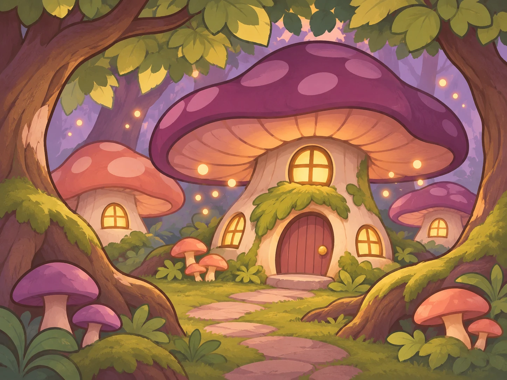
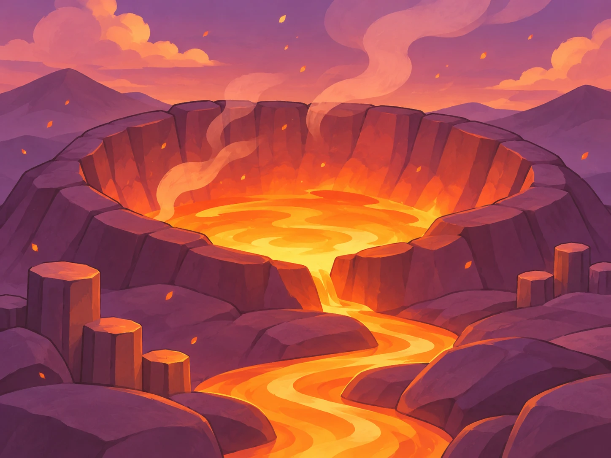

# Trois destinations pilotes — proposition v1

> **Collection complète intégrée :** les 30 destinations disposent de leur illustration, de leur histoire FR/EN et de leur autocollant souvenir. Les trois pilotes validés sont conservés ; les 27 ajouts sont des propositions à relire en jeu. Voir [le catalogue illustré et les sources](DESTINATION_COLLECTION.md). La décoration de la valise (phase C) et les Escales enchantées restent à développer. Les mentions de trois pilotes ou de placeholders ci-dessous décrivent les étapes antérieures.

**Statut : style des trois illustrations validé par le joueur après essai.** Les histoires FR/EN restent des propositions éditoriales. Cette première série sert désormais de référence visuelle pour les 27 autres destinations. Les recettes et règles du catalogue restent inchangées.

## Direction visuelle

Cartes postales peintes, cartoon chaleureux, contours bruns doux et formes arrondies. Trois ambiances distinctes partagent les mêmes volumes simples et lumières colorées : lagon turquoise, sous-bois violet et mousse, volcan prune et orange. Les illustrations ne contiennent aucun texte, afin de fonctionner dans les deux langues.

Les résultats et fiches du carnet montrent l'image entière, sans étirement : deux pages de même largeur en paysage, avec le pli exactement au centre, image au-dessus de l'histoire en portrait. Leur nouvel habillage évoque un carnet ouvert : papier crème légèrement grainé, reliure caramel, pli cousu et coins de carte dorés. Les boutons prennent la forme de languettes de papier aux bords déchirés, fixées par deux morceaux de scotch translucide en haut à droite et en bas à gauche, avec texte brun ; le pli central discret de la première version a été rétabli selon la préférence du joueur. La grille du carnet utilise les mêmes illustrations pour les lieux découverts ; son habillage reste à décliner.

La révélation présente d'abord la carte, puis le titre et l'histoire. Six brèves étincelles marquent une nouvelle découverte ; une revisite reste sobre. Le bouton reste disponible immédiatement. Les fiches consultées dans le carnet sont statiques, et la préférence de réduction des animations supprime la révélation.

## L'Archipel d'Azur / The Azure Archipelago

**Pour le découvrir : Eau + Palmier.**

**FR :** Ici, les vagues rapportent des éclats de ciel. Sous les palmiers, on dit qu’en écoutant un coquillage, on entend la mer du prochain voyage.

**EN:** Here, the waves bring back fragments of sky. Beneath the palms, they say a seashell lets you hear the sea of your next journey.

## Mycélia / Mycelia

**Pour la découvrir : Arbre + Champignon.**

**FR :** À la tombée du jour, les champignons allument leurs fenêtres. Leurs spores éclairent les sentiers, pour que même les voyageurs égarés trouvent une porte accueillante.

**EN:** At dusk, the mushrooms light their windows. Their spores illuminate the paths, so even lost travellers can find a welcoming door.

## Le Cœur de braise / The Ember Heart

**Pour le découvrir : Feu + Roche.**

**FR :** Sous la pierre sombre, le monde garde un cœur incandescent. Chaque braise qui s’envole emporte un peu de sa chaleur vers les terres où l’hiver s’attarde.

**EN:** Beneath the dark stone, the world keeps a glowing heart. Each drifting ember carries a little of its warmth to lands where winter lingers.

Les textes exécutés par le jeu restent externalisés dans [`fr.json`](../src/data/fr.json) et [`en.json`](../src/data/en.json). Les paragraphes ci-dessus consignent la proposition v1 pour relecture.

## Sources et intégration

- Génération par l'outil intégré **image_gen**, à partir d'une direction commune. [Prompts complets et statut](../designs/destinations/pilot-v1/prompts.json).
- [Sources PNG conservées](../designs/destinations/pilot-v1/) : 1448 × 1086 px, ratio 4:3. La génération a fourni cette résolution ; les prompts visaient 1024 × 768.
- [Assets WebP du jeu](../public/assets/destinations/) : mêmes dimensions et composition, environ 535 Ko pour les trois fichiers. Conversion par canvas sans retouche ni recadrage.
- Les chemins proviennent de `destinations.json`. La limitation historique aux trois pilotes a été supprimée : les 30 images sont maintenant chargées depuis ce catalogue. Une texture indisponible utilise toujours le dessin temporaire.

Le joueur a retenu le carnet et sa présentation. Le ton des petites histoires reste une proposition éditoriale. Le style des trois illustrations est retenu ; les 27 autres illustrations sont désormais intégrées dans la [collection complète](DESTINATION_COLLECTION.md), pour relecture en jeu.
